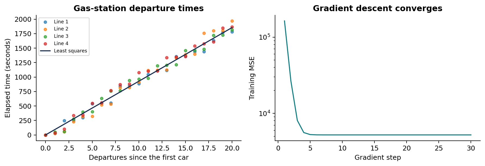
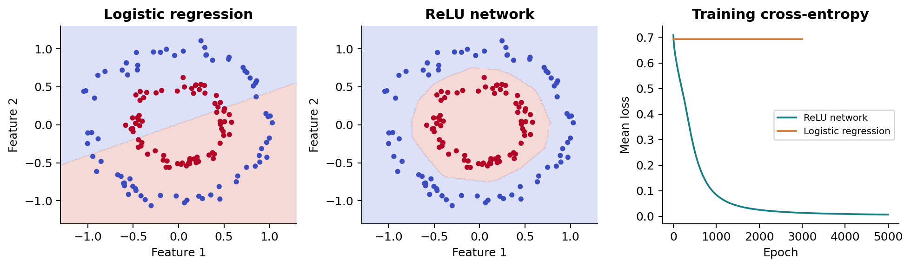
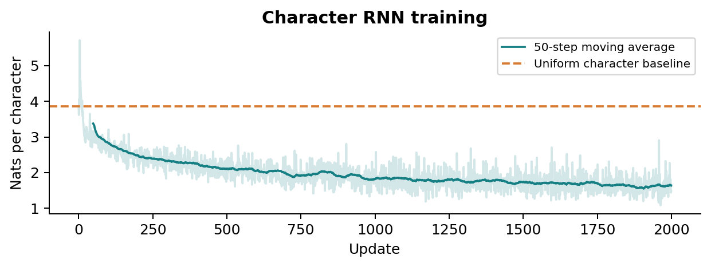
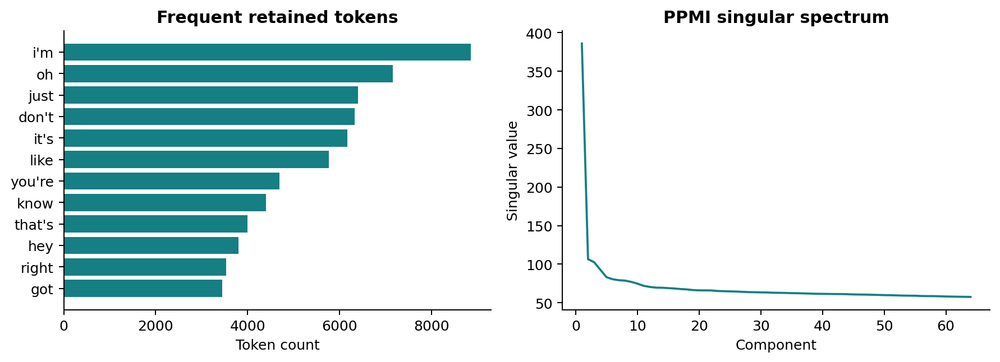
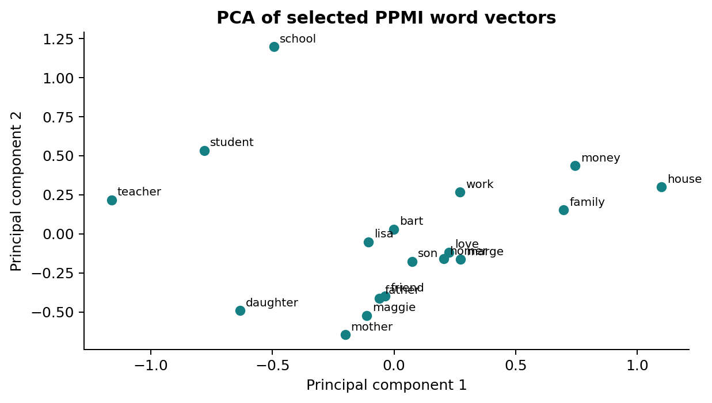
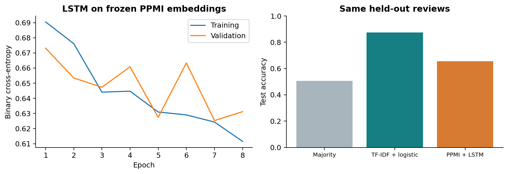
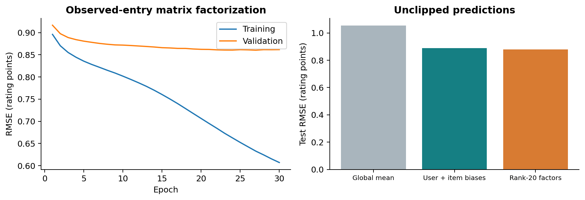

# Linear Algebra for Machine Learning

Barda Soltani Moakhar and Setayesh Heydari  
Linear Algebra | Instructor: Maryam Ramezani

## 1. Project overview

Linear Algebra for Machine Learning connects prediction, language representation, and movie recommendation through matrix operations. The project asks how far linear structure can take each task and what additional assumptions are needed when a linear model is insufficient.

The work has three parts. The first derives and trains regression and classification models, then implements a character RNN. The second constructs a word-vector space with sparse co-occurrence matrices and truncated SVD, and applies the vectors to sentiment classification. The third predicts missing movie ratings through regularized user-item factorization.

| Experiment | Evaluation result |
| --- | --- |
| Gas-station least squares | Validation R-squared 0.9829 |
| Circles: logistic / ReLU network | 50.7% / 100.0% test accuracy |
| Five-class softmax | 96.7% test accuracy |
| IMDb: TF-IDF / PPMI-LSTM | 87.4% / 65.5% test accuracy |
| MovieLens rank-20 factorization | 0.8791 test RMSE |

The main models use NumPy with explicit derivatives. Scikit-learn supplies synthetic datasets, data splitting, metrics, dimensionality-reduction utilities, and the TF-IDF logistic baseline. SciPy supplies sparse matrices, numerical functions, and a sparse least-squares solver.

Two results shape the interpretation. A nonlinear hidden layer solves the concentric-circle example that a linear boundary cannot represent. For sentiment, the TF-IDF baseline substantially outperforms the LSTM. Model complexity alone does not compensate for weak input coverage or limited training data.

## 2. Data and evaluation protocol

| Dataset | Preparation and split |
| --- | --- |
| Gas station | 21 departures in each of 4 queues; first 3 queues train, fourth validates. |
| Synthetic classes | 500 circles and 500 five-class blobs; 350 train / 150 test in each task. |
| Character text | 3,668 characters in a purpose-written demo corpus; contiguous 80/20 split. |
| Simpsons dialogue | 158,314 source rows; 93,206 retained sentences after cleaning. |
| IMDb subset | 5,000 source reviews; 4,997 after cleaning and deduplication; 60/20/20. |
| MovieLens | 100,836 ratings; 80/10/10 split with 10,084 test entries. |

All random splits and initializations use seed 42. Synthetic classification splits are stratified. The softmax feature scaler is fitted only on the training rows. IMDb reviews are normalized before duplicate removal; conflicting labels for the same normalized text are removed. Vocabulary statistics for TF-IDF come from training reviews alone. The PPMI embedding corpus is separate Simpsons dialogue and uses no IMDb labels.

The sentiment validation split selects the epoch with the lowest cross-entropy. The rating validation split selects the epoch with the lowest RMSE. Each selected model is then evaluated on a separate test split. The simple classification demonstrations use fixed hyperparameters, with no model search on their test examples.

The supplied IMDb CSV has no documented sampling procedure or official train/test identifiers. Its results describe this local subset and random split, not the standard Stanford IMDb benchmark. The MovieLens snapshot is a development dataset from September 2018, and random rating splits do not simulate deployment on future ratings.

The repository includes the small numeric datasets and the demo corpus. Simpsons and IMDb CSVs can be imported locally from the course archive. Their upstream redistribution terms were not supplied. GloVe vectors are an optional external input; no pretrained GloVe result is reported in this run. SHA-256 fingerprints and package versions are stored in results/environment.json.

## 3. Least squares and gradient descent

For each queue, timestamps are converted to seconds and shifted by its first observed departure. The feature x is the number of departures since that first car, starting at zero. The target y is elapsed time. The zero-intercept model is y_hat = wx; it estimates a service-throughput trend, rather than an individual waiting-time measurement.

$$
J(w)=\frac{1}{n}\|xw-y\|_2^2,\qquad w^*=\frac{x^Ty}{x^Tx}
$$

The fitted slope is 92.723113 seconds per departure. Training R-squared is 0.984399; held-out-line R-squared is 0.982890, with RMSE 74.98 seconds. Both the analytic solution and 30 gradient steps agree to less than 1e-10 in the slope.

$$
w_{t+1}=w_t-\eta\frac{2}{n}x^T(xw_t-y)
$$

The MSE Hessian is 2(x^T x)/n. Gradient descent therefore converges when 0 < eta < n/(x^T x), approximately 0.007317 for this design. The run uses eta = 0.005. A loss defined with an additional factor of one half would have a different numerical learning-rate bound.

Figure 1. Departure-time observations and convergence of gradient descent.

A perfect R-squared would require every held-out point to lie exactly on the fitted line. Unequal service durations, driver delays, and timestamp variation make that unlikely. The first validation point is zero by construction, and only one queue is held out, so this score is limited evidence about generalization to other stations or days.

## 4. Linear and nonlinear classification

Binary logistic regression maps an affine score through the sigmoid. Its mean cross-entropy gradient is X^T(p-y)/n for the weights and the mean residual for the bias. The ten-point illustrative dataset is fitted correctly, but its 100% training accuracy is not a generalization estimate.

$$
p=\sigma(Xw+b),\qquad \sigma(z)=\frac{1}{1+e^{-z}}
$$

Five-class softmax regression uses a stable row-wise normalization of logits and one-hot targets. It trains for 1,500 full-batch epochs at learning rate 0.1 on standardized features. Its test accuracy is 96.67% on 150 synthetic examples.

$$
P_{ic}=\frac{e^{Z_{ic}}}{\sum_j e^{Z_{ij}}},\qquad \nabla_W L=\frac{1}{n}X^T(P-Y)
$$

For the concentric-circle data, logistic regression reaches 50.67% test accuracy. A network with 16 ReLU units reaches 100.00% after 5,000 epochs at learning rate 0.1. Both see the same 350 training and 150 test observations.

Figure 2. Test-set boundaries and the training losses of the two circle classifiers.

The sigmoid equals one half on w^T x + b = 0, a straight line. Such a boundary cannot separate an inner ring from a surrounding outer ring. ReLU units combine several affine regions, which allows the network to represent a bounded class region. The result demonstrates expressiveness on this controlled task; it is not an estimate of performance on natural data.

## 5. Character-level recurrent modeling

The recurrent model predicts the next character from the current input and a hidden state. The included corpus is a short narrative about the project, rather than a full-book collection. Its sorted character vocabulary makes the index mapping deterministic.

$$
h_t=\tanh(W_xx_t+W_hh_{t-1}+b_h),\qquad p_t=\mathrm{softmax}(W_yh_t+b_y)
$$

The model has 48 hidden units and 47 character types. Training uses 2,000 randomly chosen windows of length 32, mean next-character cross-entropy, Adagrad with learning rate 0.08, and elementwise gradient clipping to [-5, 5]. Every independent random window starts at a zero hidden state. This avoids carrying unrelated context between windows.

Figure 3. Per-window character loss and a moving average during RNN training.

| Evaluation | Mean negative log-likelihood |
| --- | --- |
| Uniform distribution over the character vocabulary | 3.8501 nats/character |
| Training passage | 1.6004 nats/character |
| Contiguous held-out passage | 2.3722 nats/character |

Evaluation resets the hidden state for each non-overlapping 32-character window and omits the final incomplete window. The vocabulary is fixed from the included corpus before splitting; only the vocabulary inventory, not held-out transitions, is visible during fitting. Samples use temperature 0.8 and sampling seed 123. They contain plausible fragments and malformed words. The training-versus-held-out gap indicates overfitting to a very small corpus.

Backpropagation through time sums the output loss contributions and propagates hidden-state derivatives backward through the shared recurrent weights. A finite-difference check verifies every parameter of a small test network before clipping is applied.

## 6. Sparse word embeddings

The dialogue pipeline retains 93,206 sentences. It removes HTML, lowercases alphabetic tokens, removes English stop words, and keeps sentences with at least three tokens. It applies frequency-adjusted bigram merging, with minimum pair count 20 and score threshold 10. It detects 81 phrase types. It does not lemmatize words.

The vocabulary contains the 3,000 most frequent tokens with at least ten occurrences. A context window of two tokens adds symmetric counts within each sentence. Tokens omitted from the vocabulary retain their original positions when the context distance is measured. The resulting matrix has 545,887 nonzero entries.

$$
\mathrm{PPMI}_{ij}=\max\left(\log\frac{C_{ij}\sum_{ab} C_{ab}}{(\sum_b C_{ib})(\sum_a C_{aj})},0\right)
$$

Unobserved entries remain zero. Truncated randomized SVD uses seven power iterations and seed 42. The raw-count representation uses U_k; the PPMI representation uses U_k times the square root of the retained singular values. Comparisons at 16, 32, and 64 dimensions are qualitative and change both matrix weighting and coordinate scaling. They do not isolate the effect of PPMI alone.

Figure 4. Frequent tokens and the retained singular spectrum of the PPMI matrix.

The 12-question analogy diagnostic covers only 2 questions and answers 1 correctly. Covered accuracy is 50%, but coverage is 16.7%. These counts are too small to characterize general analogy performance. Missing vocabulary is recorded rather than counted as a semantic error.

The toy semantic-coordinate exercise has approximate values x = y = z = u = 0 and v = 1: fruit coordinates are small for people and high for oranges, while apples have no gender coordinate. Real learned axes are not generally interpretable as one named concept.

## 7. Geometry and word-vector queries

$$
\cos(u,v)=\frac{u^Tv}{\|u\|_2\|v\|_2}
$$

The vector-space implementation normalizes rows, excludes the query word from its own neighbors, and rejects zero-vector queries. An analogy a:b::c:? uses b-a+c, with all three input words excluded from the candidate set. Group queries average the member vectors and exclude group members. Least-similar vectors describe opposition in the learned geometry, not necessarily linguistic antonyms.

Figure 5. PCA projection of selected PPMI vectors. Distances in this two-dimensional view do not preserve every relationship in the full space.

| Query | Top PPMI neighbors (64 dimensions) |
| --- | --- |
| homer | marge, bart, simpson, sorry, i'm |
| lisa | bart, son, mom, know, marge |
| bart | lisa, homer, son, marge, boy |
| homer + bart | marge, lisa, son, simpson, boy |

Dialogue embeddings reflect character names, repeated expressions, and the contexts present in one television corpus. A nearby word is an association learned from this text; it does not establish a personality trait. Small dimensionalities can emphasize frequent contexts and produce misleading neighbors.

The optional GloVe experiment provides a separate loader, cosine queries, the same analogy diagnostic, PCA, and t-SNE. The recorded project did not include the external 300-dimensional vectors, so no GloVe score is claimed. A PCA or t-SNE picture is exploratory; neither is a quantitative semantic evaluation.

## 8. Sentiment analysis with frozen embeddings

The supplied review CSV contains 5,000 labeled rows. After normalized-text deduplication there are 4,997 examples: 2,997 train, 1,000 validation, and 1,000 test. The LSTM reads the first 100 tokens of each review and uses fixed, row-normalized 32-dimensional PPMI embeddings learned from dialogue.

Unknown tokens and right-padding map to zero vectors. Padding positions preserve both cell and hidden states, with the same mask applied in the backward pass. Hidden and cell states start at zero for each review. Only 30.5% of the retained review tokens occur in the dialogue vocabulary; common stop words, phrase mismatches, and domain-specific terms account for part of the missing coverage.

$$
c_t=f_t\odot c_{t-1}+i_t\odot g_t,\qquad h_t=o_t\odot\tanh(c_t)
$$

The model has 24 hidden units and trains for eight epochs, with batch size 64, Adam learning rate 0.003, and global gradient-norm clipping at 5. Validation loss selects epoch 7. The TF-IDF baseline uses training-only unigram/bigram features, at most 10,000 features, minimum document frequency 2, sublinear term frequency, and logistic regularization C = 1.

Figure 6. LSTM learning curves and accuracy on the same held-out review set.

| Model | Test accuracy | Positive-class F1 |
| --- | --- | --- |
| Training-majority label | 50.7% | - |
| TF-IDF + logistic regression | 87.4% | 0.8693 |
| Frozen PPMI + LSTM | 65.5% | 0.6628 |

The baseline wins by 21.9 percentage points. Its review-domain features preserve useful sentiment phrases that may be absent from the dialogue vectors. The LSTM also sees only the first 100 tokens. These factors are plausible explanations, not isolated causal findings: this comparison changes the representation, sequence coverage, and classifier together.

## 9. Matrix factorization for recommendation

MovieLens contains 610 users, 9,724 movies with ratings, and 100,836 observed scores. Only 1.70% of the user-movie matrix is observed. The catalog contains 9,742 titles; some have tags but no ratings. Original IDs map to contiguous training indices and are restored in exported results.

$$
\hat r_{ui}=\mu+b_u+c_i+p_u^Tq_i
$$

$$
L=\frac{1}{2}\sum_{(u,i)\in\Omega}\left[(r_{ui}-\hat r_{ui})^2+\lambda(b_u^2+c_i^2+\|p_u\|_2^2+\|q_i\|_2^2)\right]
$$

The objective includes observed training entries only. The global mean is fixed from training data. SGD uses rank 20, learning rate 0.01, regularization 0.05, shuffled observations, and 30 epochs. Validation selects epoch 27. The per-observation penalty means frequently observed users and items receive more total regularization.

Figure 7. Factorization learning curves and test RMSE against two baselines.

| Predictor | Test RMSE, no clipping |
| --- | --- |
| Global training mean | 1.0545 |
| Regularized user and item biases | 0.8896 |
| Rank-20 factors with biases | 0.8791 |

The factor model reduces RMSE by 1.17% relative to the bias-only baseline. That baseline is fitted by sparse least squares with ridge penalty 10 on each bias. The models use different fixed regularization conventions; this is a practical baseline comparison rather than a controlled ablation of the factor term. Clipping factor predictions to [0.5, 5] gives RMSE 0.8790.

## 10. Recommendation limits and reproducibility

The test split contains 9,695 warm-start ratings with RMSE 0.8731, and 389 ratings involving an item absent from training with RMSE 1.0181. Unseen factor rows and biases remain zero, so their predictions fall back to the fixed mean and any learned counterpart bias. This split contains no unseen users.

The illustrative top-ten list uses original userId 201 and movies with at least 20 training ratings. It removes every film the user rated in the supplied dataset, including held-out entries, before ranking candidates. That exclusion is for a known-history showcase and is not used to calculate rating RMSE. Reported display ratings are clipped, while ordering uses the raw score.

A rating split can mix past and future behavior. RMSE also does not measure precision, recall, diversity, or user satisfaction for a recommendation list. A stronger follow-up would use a temporal split, explicit cold-start protocols, and ranking metrics. Multiple random seeds would help quantify variability in every learned model.

Correctness checks compare every parameter gradient in small MLP, RNN, and masked LSTM instances with central finite differences. Additional checks cover stable softmax at extreme logits, the scalar least-squares solution, exact sparse context counts, nonnegative PPMI values, analogy input exclusion, padding invariance, and simultaneous factor updates.

Reproduction uses scripts/run_experiments.py with --part neural, embeddings, sentiment, recommender, or all. Import the two external CSVs with scripts/prepare_data.py before the text experiments. Run python -m unittest discover -s tests -v for numerical checks. The notebooks read saved results unless RECOMPUTE is enabled. The README contains installation commands and the path to every deliverable.

The measured run uses Python 3.12.14, NumPy 2.3.5, SciPy 1.17.0, pandas 2.2.3, scikit-learn 1.8.0, and Matplotlib 3.10.8. Input hashes and exact versions are machine-readable. Small numerical differences can occur with other BLAS libraries or package versions; comparisons near a decision threshold may also change.

## Appendix A. Derivations and implementation details

Least-squares complexity. For n rows and d features, forming X^T X costs O(nd^2) and a dense factorization/solve costs O(d^3). Forming X^T y adds O(nd). Thus a normal-equation implementation costs O(nd^2 + d^3), while T full-batch gradient steps cost O(Tnd). The scalar case is O(n) analytically and O(Tn) iteratively. The code uses lstsq, avoiding an explicit inverse; a QR-based solve also avoids squaring the condition number.

Affine-layer composition. Removing the hidden activation gives Z_2 = (XW_1 + b_1)W_2 + b_2 = X(W_1W_2) + b_1W_2 + b_2. Define W_prime = W_1W_2 and b_prime = b_1W_2 + b_2. With a sigmoid output, this is a logistic model. For the binary setting, a nonempty hidden layer can represent any such affine score. In multiclass settings, a narrow bottleneck can impose an additional rank constraint.

ReLU-network gradients. Let A_1 = ReLU(Z_1), P = sigmoid(Z_2), and D_2 = (P-y)/n. Then dW_2 = A_1^T D_2, db_2 = sum_rows(D_2), D_1 = (D_2 W_2^T) elementwise-multiplied by 1[Z_1 > 0], dW_1 = X^T D_1, and db_1 = sum_rows(D_1). Gradient checks avoid ReLU points at exactly zero, where the derivative is not unique.

RNN gradients. For each timestep, dZ_y = (p_t - one_hot(y_t))/T. Add the recurrent contribution to W_y^T dZ_y, then multiply elementwise by (1-h_t^2) to differentiate tanh. Accumulate outer products into W_x, W_h, and W_y, and propagate W_h^T dZ_h to the previous step. Every timestep shares the same parameter matrices.

LSTM gates. A single affine map of [x_t, h_(t-1)] supplies forget, input, output, and candidate gates. The first three use sigmoid and the candidate uses tanh. The forward and backward masks preserve states at right-padding positions. The classifier reads the final valid hidden state. Frozen embeddings receive no parameter updates.

Factor gradients. With error e = r - r_hat, a user-factor step is p_u <- p_u + eta(e q_i - lambda p_u), and the item-factor step is q_i <- q_i + eta(e p_u_old - lambda q_i). Biases follow the same residual-minus-penalty rule. Copies of both factor vectors ensure that each update uses the same pre-update state.

SVD and incomplete data. The truncated SVD gives a best rank-k Frobenius approximation to a fully observed matrix. The rating model instead optimizes a regularized loss over the observed index set Omega. It is nonconvex and is not guaranteed to reach that complete-matrix SVD solution. Filling missing ratings with zero changes the problem and introduces artificial low ratings.

## References and credits

Project team: Barda Soltani Moakhar and Setayesh Heydari. Course: Linear Algebra. Instructor: Maryam Ramezani. The experiments develop the topics and datasets in Practical Assignment 2.

F. Maxwell Harper and Joseph A. Konstan. 2015. The MovieLens Datasets: History and Context. ACM Transactions on Interactive Intelligent Systems 5(4), Article 19. https://doi.org/10.1145/2827872

Jeffrey Pennington, Richard Socher, and Christopher D. Manning. 2014. GloVe: Global Vectors for Word Representation. EMNLP. https://nlp.stanford.edu/projects/glove/

Tomas Mikolov, Kai Chen, Greg Corrado, and Jeffrey Dean. 2013. Efficient Estimation of Word Representations in Vector Space. https://arxiv.org/abs/1301.3781

Andrew L. Maas and colleagues. 2011. Learning Word Vectors for Sentiment Analysis. ACL. Original dataset information: https://ai.stanford.edu/~amaas/data/sentiment/

GroupLens. MovieLens latest-small dataset and usage conditions. https://grouplens.org/datasets/movielens/latest/ . The unchanged README accompanying the supplied September 2018 snapshot is included with the data.

The Simpsons and IMDb CSVs are course-provided inputs. Their upstream versions were not documented in the archive. References to the original dataset projects do not establish an exact upstream match for these files. DATA_SOURCES.md records these limits and the local import procedure.
